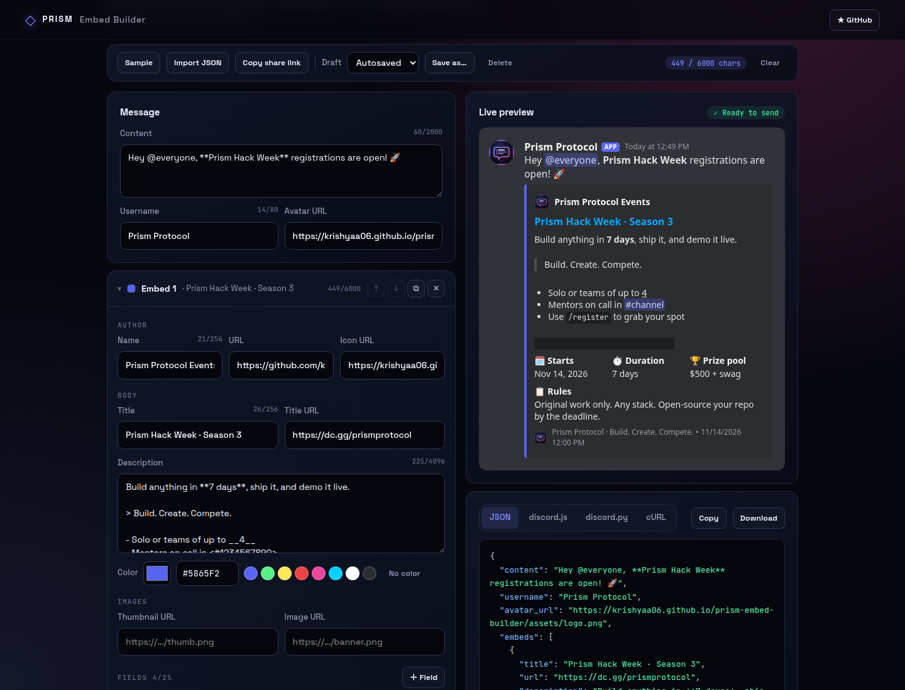
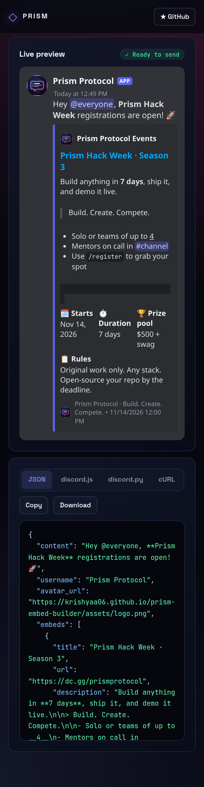

<!-- ═════════════ HEADER ═════════════ -->
<p align="center">
  
</p>

<p align="center">
  
</p>

<p align="center">
  <a href="https://github.com/krishyaa06/prism-embed-builder/actions/workflows/ci.yml"></a>
  <a href="https://krishyaa06.github.io/prism-embed-builder/"></a>
  
  
  
  <a href="LICENSE"></a>
</p>

<p align="center">
  
</p>


## ⚡ Overview

**Prism Embed Builder** is a private, in-browser editor for Discord embeds and webhook messages. Type on the left and watch a Discord-style preview update on the right, with live character counters and warnings for every Discord limit. When it looks right, copy the JSON payload or ready-to-run **discord.js**, **discord.py** or **cURL** code, or send it straight to a webhook. There is no backend: nothing leaves your browser unless you press **Send**.

## ✨ Features

- **Full message editor**: content, webhook username and avatar, and up to **10 embeds**
- **Every embed field**: author (name, URL, icon), title + URL, description, color picker with presets, thumbnail, image, footer (text, icon), timestamp
- **Up to 25 fields** per embed with inline toggle, reorder and delete; embeds can be reordered and duplicated
- **Discord-like live preview** (dark theme) with inline field layout (3 per row, 2 next to a thumbnail)
- **Discord markdown**: `**bold**`, `*italic*`, `__underline__`, `~~strike~~`, `` `code` ``, code blocks, `||spoilers||`, `[masked links](https://…)`, auto links, headings, `-#` subtext, quotes, lists, `<@user>` `<@&role>` `<#channel>` `@everyone` mentions, `<t:…>` timestamps and custom emoji
- **Limit checks** with counters and inline warnings: title 256, description 4096, field name 256 / value 1024, footer 2048, author 256, content 2000, 25 fields, 10 embeds and the **6000 character** total, plus URL, color, timestamp and username checks
- **Export** as raw JSON, **discord.js v14** `EmbedBuilder` code, **discord.py** `discord.Embed` code, or a **cURL** command; copy or download
- **Import JSON**: webhook payloads, a single embed, an array of embeds or a Discohook backup
- **Send to webhook** via `fetch` POST. The webhook URL is **never saved** unless you tick “Remember on this device”, and never goes into share links
- **Share via URL**: the whole message is encoded in the link hash, so no server is involved
- **Drafts**: automatic local autosave plus named drafts in `localStorage`

## 📸 Screenshots

<table>
  <tr>
    <td width="68%"></td>
    <td width="32%"></td>
  </tr>
</table>

## 🚀 Quick Start

**Use it online:** [https://krishyaa06.github.io/prism-embed-builder/](https://krishyaa06.github.io/prism-embed-builder/)

**Run locally:**

```bash
git clone https://github.com/krishyaa06/prism-embed-builder.git
cd prism-embed-builder
# open index.html in your browser, or serve it:
npx serve .
```

## 🛠️ Usage

| Action | How |
| --- | --- |
| Edit | Fill in **Message** and each **Embed** card; counters turn yellow near a limit and red past it |
| Fields | **＋ Field** adds one, tick **Inline** to place fields side by side |
| Export | Switch tabs: **JSON**, **discord.js**, **discord.py**, **cURL**, then **Copy** or **Download** |
| Import | **Import JSON** accepts a payload, an embed, an embed array or a Discohook backup |
| Send | Paste a webhook URL (*Server Settings → Integrations → Webhooks*) and press **Send message** |
| Share | **Copy share link** puts the message in the URL hash (the webhook URL is never included) |
| Drafts | Work is autosaved; **Save as…** keeps named drafts in this browser |

### Example output (discord.js)

```js
const { EmbedBuilder, WebhookClient } = require("discord.js");

const embed1 = new EmbedBuilder()
  .setTitle("Prism Hack Week · Season 3")
  .setColor(0x5865F2)
  .addFields(
    { name: "🗓️ Starts", value: "Nov 14, 2026", inline: true },
    { name: "⏱️ Duration", value: "7 days", inline: true }
  )
  .setTimestamp(new Date("2026-11-14T12:00:00.000Z"));

const webhook = new WebhookClient({ url: process.env.WEBHOOK_URL });
await webhook.send({ username: "Prism Protocol", embeds: [embed1] });
```

## 🔒 Privacy

- Everything runs client-side; there is no server, analytics or tracking.
- The only network request the app makes on your behalf is the webhook `POST` when you press **Send** (plus loading the images you reference in the preview).
- Webhook URLs are kept in memory only, unless you opt in to remember them on your device. Untick the box to delete it.

## 📁 Project Structure

```text
prism-embed-builder/
├── assets/
│   ├── logo.png
│   ├── logo.svg
│   └── screenshots/
├── css/
│   ├── app.css     # editor + Discord-like preview
│   └── prism.css   # shared Prism design system
├── js/
│   ├── app.js      # UI wiring
│   ├── core.js     # pure logic (limits, validation, markdown, code generators, share links) — tested in Node
│   └── prism.js
├── scripts/
│   └── screenshots.js   # optional: regenerate screenshots with Playwright
├── test/
│   └── core.test.js
├── .github/workflows/ci.yml
├── LICENSE
├── README.md
├── index.html
└── package.json
```

## 🧪 Tests

```bash
npm test
```

Tests use the built-in `node:test` runner, so there is nothing to install. They cover limits and validation, payload cleaning, import formats, share links, the markdown parser (including HTML escaping) and the discord.js / discord.py / cURL generators. CI runs them on Node 20 and 22.

## 🤝 Contributing

1. Fork the repo and create a branch: `git checkout -b feature/my-idea`
2. Make your change and add a test in `test/`
3. Run `npm test` and open a Pull Request

## 🔷 Part of Prism Protocol

Prism Embed Builder is one of the open-source tools built by [Prism Protocol](https://dc.gg/prismprotocol), a tech community where young builders learn, ship and compete together.

## 👤 Author

<table>
  <tr>
    <td align="center">
      <a href="https://github.com/krishyaa06"><br><b>Soumya Bhandare</b></a><br>
      <sub>Founder @ Prism Protocol</sub>
    </td>
    <td>
      <a href="https://dc.gg/prismprotocol"></a><br>
      <a href="https://instagram.com/prism_protocol_"></a><br>
      <a href="https://x.com/krishyaa06"></a>
    </td>
  </tr>
</table>

## 📄 License

Released under the [MIT License](LICENSE).

<p align="center">
  <b>If you like this project, consider giving it a ⭐</b><br>
  <sub>"Build. Create. Compete." · Made with ⚡ by Prism Protocol</sub>
</p>


